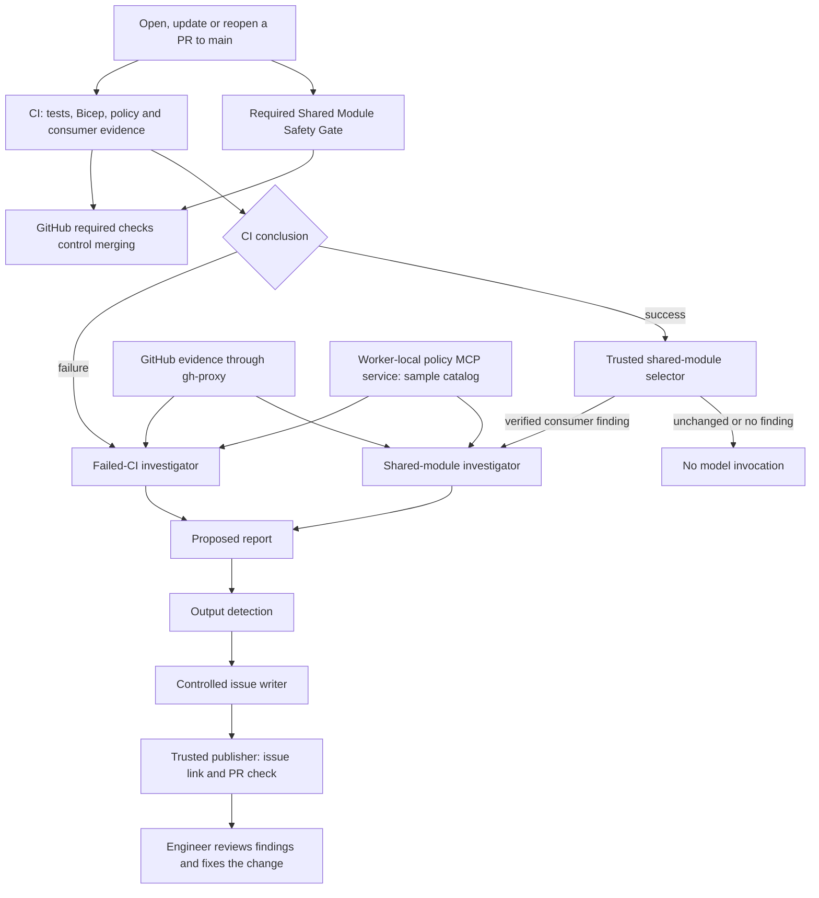

# When CI Fails

## Governed investigation with GitHub Copilot and MCP

Session reference for **GitHub Dev Days 2026**, delivered on **17 October 2026** at **Microsoft Sri Lanka** by **Nikila Fernando**.

A failed check tells us that something is wrong. Resolving it can also require the changed code, other failed jobs, policy context, and the applications that depend on a shared module. This project demonstrates how GitHub Agentic Workflows can gather that evidence and explain the next step inside the pull request.

**Deterministic checks control merging. The agent investigates and proposes corrections for a human to review.** It cannot change code, deploy infrastructure, or approve an exception.

## Two examples

| Example | Deliberate change | Expected checks | Investigation |
| --- | --- | --- | --- |
| Build failure and independent policy violation | Rename a network-module output without updating its caller; enable public network access in the active production parameters | Application tests pass; Bicep compilation fails; deployment policy fails; unchanged shared module passes its safety gate | Explain both causes separately, cite the changed code and policy evidence, and propose a correction for each |
| Shared default affects another consumer | Change the hosting module's `zoneRedundant` default from `true` to `false`; the root caller still supplies `true` | Root tests, compilation and policy pass; consumer assessment records a finding; **Shared Module Safety Gate fails** | After successful baseline CI, verify the selected consumer evidence and explain why the inheriting sample consumer no longer meets its requirement |

In the second example, a successful investigation means its report was delivered. The required consumer gate stays red until the requirement is satisfied. The intentional failures are examples to reproduce on separate feature branches; do not merge them into the baseline.

See [demo steps and expected results](docs/demo-scenarios.md) and the [registered sample consumers](fixtures/shared-module-consumers/README.md).

## How it works



- **Ordinary CI** runs independent checks and uploads evidence. The separate consumer gate enforces its registered requirement without a model or inference credentials.
- **Agentic workflow Markdown** defines the trigger, instructions, tools, limits and permitted outputs. Its compiled `.lock.yml` runs in GitHub Actions.
- **`gh-proxy`** provides the configured GitHub evidence path. The **policy MCP service** is separate: a temporary Node service started on the investigation worker at `http://localhost:8765/mcp`. It validates tool arguments and returns versioned sample policy and ownership context over HTTP/JSON-RPC.
- **Contracts and provenance** describe evidence and response shapes. The shared-module selector verifies source identities, digests, trusted wrappers and derived values before model activation; a claimed artifact status alone is insufficient.
- **Controlled publishing** separates investigation from GitHub writes. Permitted issue outputs pass detection and a restricted writer. Trusted publisher code verifies delivery and the current PR head before posting a managed issue-link comment and completing the investigation check.

Logs, artifacts, diffs, commit messages and MCP responses are untrusted evidence. Missing context is an unknown, never permission to bypass a check.

## Repository map

| Path | Purpose |
| --- | --- |
| [`.github/workflows/`](.github/workflows/) | CI, required consumer gate, agentic Markdown sources and compiled workflows |
| [`src/`](src/) and [`tests/`](tests/) | Small Azure Functions example, investigation helpers and regression tests |
| [`infra/`](infra/) | Bicep application, reusable modules and parameter fixtures |
| [`policy/`](policy/) | Versioned sample deployment, ownership and change-window context |
| [`mcp-policy/`](mcp-policy/) | Read-only policy MCP implementation |
| [`contracts/`](contracts/) | Evidence/report schemas and policy-response contract |
| [`fixtures/shared-module-consumers/`](fixtures/shared-module-consumers/) | Two registered sample callers and their requirement |
| [`scripts/`](scripts/) | Policy/preflight checks, evidence packaging, consumer assessment, selection and PR feedback |

## Run locally

Prerequisites:

- Node.js **20.19+, 22.12+, or 24+**, npm and Git; CI uses the latest Node 20.
- Azure CLI with the Bicep compiler installed for compilation and consumer checks. These commands require **no Azure sign-in, subscription or deployment**. Alternatively, set `BICEP_BINARY` to an installed standalone Bicep executable for the demo verifier and consumer assessor.

```sh
npm ci
npm test
npm run typecheck
npm run build
npm run validate:policy
az bicep build --file infra/main.bicep --outfile /tmp/session-template.json --no-restore
npm run verify:session-demos
```

The demo verifier creates intentional defects in a temporary directory and checks real compiler diagnostics, independent policy failures, individual corrections, and both registered consumers. It prints its evidence location. It does not edit the working tree, start an agent, consume AI credits or provision Azure resources.

To inspect the policy MCP service locally:

```sh
npm run build
npm run mcp:serve -- --http 8765
```

Use an MCP client with `http://localhost:8765/mcp`. This is a protocol endpoint, not a browser dashboard. The service is an isolated demo fixture; do not expose it as an authenticated enterprise policy endpoint.

## Run on GitHub

### Install and configure

1. Use a repository with GitHub Actions and the relevant GitHub Copilot inference access. Inspect the workflow sources before enabling paid investigation runs.
2. Set the Actions repository variable **`DISABLE_CI_INVESTIGATOR=true`** while configuring. Leave it `true` for deterministic checks only; set it to **`false`** to enable both investigation paths. An absent variable also allows activation. The switch skips new eligible investigations; cancel already-running workflows separately.
3. Configure **`COPILOT_GITHUB_TOKEN`** as an Actions secret for Copilot inference. GitHub supplies **`GITHUB_TOKEN`** to workflow jobs. Optional compiled-runtime overrides **`GH_AW_GITHUB_MCP_SERVER_TOKEN`** and **`GH_AW_GITHUB_TOKEN`** change effective GitHub authority: leave them unset unless needed and scope any configured override carefully. Job permissions do not narrow a separate token's scopes.
4. Install the Markdown sources **and** compiled workflows on the default branch, `main`. GitHub loads `workflow_run` automation from the default branch; changing only a feature branch does not install the investigator.
5. Configure branch protection or a ruleset requiring these check names from the GitHub Actions app: **Application Tests**, **Bicep Syntax & Template Validation**, **Deployment Policy Check**, and **Shared Module Safety Gate**. Require up-to-date checks and apply protection to administrators if they must also be blocked. Repository files alone do not configure these protections.

The checked-in workflows were generated with **gh-aw v0.89.21**. To edit agentic workflow definitions, use that compiler version and review both source and generated output together:

```sh
gh extension install github/gh-aw --pin v0.89.21
gh aw compile ci-investigator shared-module-investigator --strict
```

### Trigger a demo

Create a feature branch from the clean `main`, make one example change, commit and push it, then **manually open a PR targeting `main`**. Follow the [scenario guide](docs/demo-scenarios.md) for the exact edits and corrections.

- Branch creation or a push **without a PR does not start scans or investigation**. Opening, updating or reopening a PR starts CI and the consumer gate; draft PRs are included.
- Failed `CI` activates the failed-CI investigator. Successful `CI` can reach the shared-module selector; only a verified, selected finding starts its model. Existing verified shared-report occurrences can recover delivery without another model run.
- Investigators accept **same-repository PRs** targeting `main`; fork PRs can run ordinary CI but do not activate these privileged investigation paths. Review GitHub's workflow-approval settings for public forks separately.
- `CI Investigation` and `Shared Module Review` are asynchronous report/check signals. They do not replace the required checks or authorize merging.

### Model use and budgets

Each workflow source configures **120 AI credits for its agent execution** and a **10-minute agent timeout**. Detection has a separate budget: the compiled workflows default to **400 AI credits**, overridable with repository variable **`GH_AW_DEFAULT_DETECTION_MAX_AI_CREDITS`**. The agent setting is not a total workflow budget or duration cap.

The compiled runtime resolves model selection from **`GH_AW_MODEL_AGENT_COPILOT`**, then **`GH_AW_DEFAULT_MODEL_COPILOT`**, then `auto`. Inspect actual run usage and model metadata; no fixed dollar cost or general ROI is promised. Shared-module selection and replay recovery reduce unnecessary inference. The failed-CI path currently considers eligible failed CI runs rather than using a general failure-value selector.

## Scope and limitations

- Bicep is the example workload. The investigation pattern applies more broadly, but this repository does not implement a Terraform or Python infrastructure platform.
- Policy rules, owners and contact details are sample data. The parameter validator and offline IPv4 subnet preflight do not establish effective Azure deployment compliance or runtime health.
- Shared-module assessment covers two registered wrappers and a single literal `zoneRedundant` default edit. Unsupported edits or incomplete evidence require manual review and fail the required gate. There is no automatic cross-repository discovery or deployed-state inspection.
- The MCP scope allowlist filters request values; it is not caller authentication or tenant authorization. A real organizational service needs an authenticated, authorized context source and appropriate inventory/freshness controls.
- Source run, attempt, head SHA and tested merge SHA matter. Evidence digests detect mismatches; they do not independently authenticate an artifact. Missing evidence must remain explicit.
- Safe outputs and checks constrain delivery, but do not prove that every narrative claim is correct or guarantee atomic deduplication across all concurrent incidents. Review the report and its evidence.

## Further reading

- [Demo scenarios](docs/demo-scenarios.md)
- [Operating runbook](docs/OPERATING-RUNBOOK.md)
- [PR activation and investigation feedback](docs/pr-investigation-flow.md)
- [Required shared-module merge gate](docs/shared-module-merge-gate.md)
- [Contributing](CONTRIBUTING.md) · [Security reporting](SECURITY.md) · [MIT license](LICENSE)
